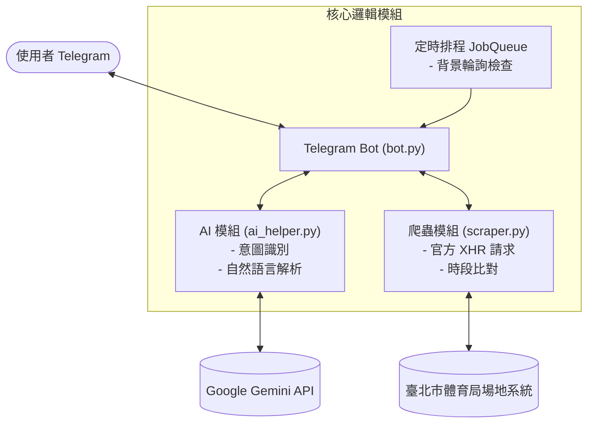

# 🎾 TennisCourtMonitor - 臺北市網球場時段即時監控系統

[](https://www.python.org/)
[](https://core.telegram.org/bots/api)
[](https://ai.google.dev/)
[](LICENSE)

基於 **Python + Telegram Bot + Google Gemini AI** 的臺北市公有網球場時段即時監控與智慧推播系統。

支援自然語言查詢、定時背景排程、精準狀態比對與釋出空位即時通知。

---

## ✨ 核心特色

- ⚡ **即時動態爬蟲**：直接解析官方 `LoadSched` XHR API，精準獲取每個場地的即時預約狀態與預訂人/活動名稱。
- 🤖 **Gemini AI 雙向驅動**：
  - **意圖與時間推理**：支援口語化日期描述（如「下週六」、「這兩天」、「5/20 以後」），自動推理並展開為精確日期清單。
  - **客製化格式化**：能根據使用者具體需求（如「只要列出下午的空位」）動態調整回覆格式。
- 🛡️ **高容錯備援機制**：
  - 具備本地正則表達式備援；即使 AI API 遇配額限制或連線中斷，核心查詢與監控功能仍正常運作。
  - Telegram 訊息安全降級機制，防範 Markdown 解析異常導致的服務中斷。
- 🔔 **背景定時監控**：整合 Telegram `JobQueue`，背景定時輪詢，偵測到新釋出的空位即時推送通知。
- 💻 **跨平台相容**：針對 Windows 環境優化 UTF-8 主控台輸出，避免字元編碼異常。

---

## 🏗️ 系統架構



---

## 🚀 快速開始

### ⚡ 方案 A：一鍵自動化腳本啟動（推薦）

專案內建跨平台啟動腳本，具備環境檢測、依賴安裝與自動化啟動功能：

1. **配置環境變數**：
   複製專案目錄下的 `.env.example` 並重新命名為 `.env`，填入 `TELEGRAM_BOT_TOKEN` 與 `GOOGLE_API_KEY`。
2. **執行啟動腳本**：
   - **Windows**：直接執行專案根目錄的 **`start.bat`**。
   - **macOS / Linux**：於終端機執行 **`./start.sh`**。

> 腳本將自動建立虛擬環境、安裝相依套件並啟動服務。

---

### 💻 方案 B：手動建置與啟動 (CLI)

```bash
# 1. 複製儲存庫
git clone https://github.com/LNSY116/Tennis-Monitor.git
cd Tennis-Monitor

# 2. 建立並啟用虛擬環境
python -m venv venv
# Windows:
venv\Scripts\activate
# Linux/macOS:
# source venv/bin/activate

# 3. 安裝相依套件
pip install -r requirements.txt

# 4. 配置環境變數
cp .env.example .env
# 請編輯 .env 填入 API 金鑰與相關配置

# 5. 系統自我檢驗 (選用)
python tools/verify_system.py

# 6. 啟動主服務
python main.py
```

---

## 💬 使用方式

系統支援自然語言交談與標準斜線指令：

### 自然語言查詢範例
- `幫我查明天下午有沒有空位`
- `下週六如果有人退訂請通知我`
- `5/20以後哪天有場地？`

### 標準指令

| 指令 | 說明 | 範例 |
| :--- | :--- | :--- |
| `/check <日期>` | 即時查詢指定日期的空位狀態 | `/check 5/20` 或 `/check 0518-20` |
| `/monitor <日期>` | 訂閱空位通知，有空位釋出時自動推播 | `/monitor 5/25` |
| `/list` | 查看當前監控中的日期清單 | `/list` |
| `/stop` | 取消所有監控訂閱 | `/stop` |
| `/help` | 顯示使用說明與功能清單 | `/help` |

---

## 📁 專案目錄結構

```text
Tennis-Monitor/
├── start.bat          # Windows 自動化環境配置與啟動腳本
├── start.sh           # Linux / macOS 自動化環境配置與啟動腳本
├── main.py            # 應用程式主進入點
├── requirements.txt   # 相依套件清單
├── .env.example       # 環境變數設定範本
├── README.md          # 專案說明文件
├── LICENSE            # MIT 開源授權合約
│
├── src/               # 核心業務模組
│   ├── bot.py         # Telegram 機器人核心與互動邏輯
│   ├── scraper.py     # 場地預約系統 XHR 爬蟲引擎
│   ├── ai_helper.py   # Gemini AI 意圖分析與對話格式化
│   └── config.py      # 環境變數載入與配置校驗
│
├── tools/             # 診斷與測試工具
│   ├── verify_system.py # 系統端到端自我檢驗腳本
│   └── check_models.py  # Gemini API 可用模型查詢工具
│
└── docs/              # 專案文檔與技術除錯分析報告
```

---

## 🛠️ 開發與診斷工具

- **查詢可用的 Gemini 模型清單**：
  ```bash
  python tools/check_models.py
  ```
- **執行系統完整性檢測**：
  ```bash
  python tools/verify_system.py
  ```

---

## 📄 開源授權

本專案採用 [MIT License](LICENSE) 授權條款開源。
僅供程式開發研究與技術交流使用，請遵守目標網站服務條款，勿用於高頻或惡意請求。
